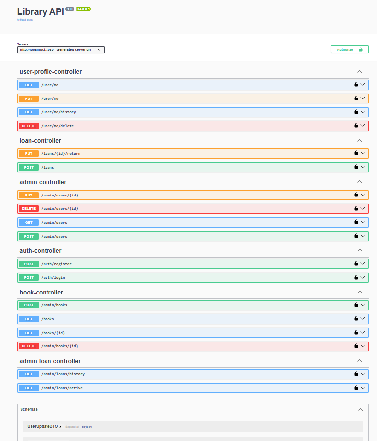
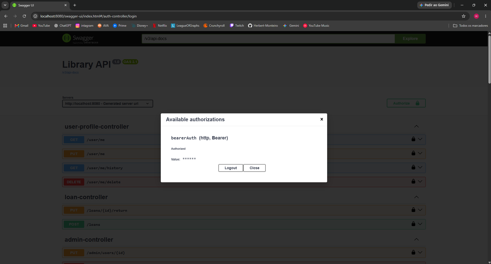
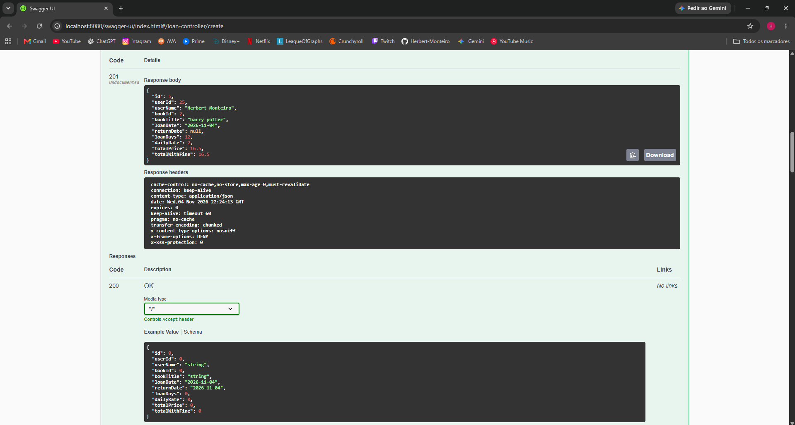

# Library API

API REST de gerenciamento de biblioteca: cadastro de usuários e livros, empréstimos com cálculo de preço e multa por atraso, autenticação JWT e controle de acesso por perfil (ADMIN/USER).

Projeto de portfólio. O frontend será desenvolvido em uma próxima etapa.

## Funcionalidades

- Autenticação e autorização com JWT
- Perfis ADMIN e USER
- CRUD de livros com controle de estoque
- Empréstimos com preço progressivo por dia e multa composta em caso de atraso
- Exclusão de conta com soft delete (bloqueada se houver empréstimo ativo)
- Paginação nas listagens
- Tratamento global de exceções
- Documentação interativa com Swagger/OpenAPI

## Stack

- Java 17
- Spring Boot 3.5 (Web, Data JPA, Security, Validation)
- MySQL 8
- JWT (jjwt 0.11.5)
- springdoc-openapi (Swagger UI)
- Lombok
- Gradle (wrapper incluso)

## Pré-requisitos

- JDK 17
- MySQL 8 em execução
- Git

Não é preciso instalar o Gradle, o projeto usa o wrapper (`gradlew`).

## Como rodar

1. Clone o repositório:

   ```bash
   git clone https://github.com/Herbert-Monteiro/user-management-api.git
   cd user-management-api
   ```

2. Crie o banco de dados e as tabelas no MySQL:

   ```sql
   CREATE DATABASE user_management_api;
   ```

   Depois execute o script `database/schema.sql` nesse banco:

   ```bash
   mysql -u seu_usuario -p user_management_api < database/schema.sql
   ```

3. Crie o arquivo de configuração a partir do exemplo:

   ```bash
   cp src/main/resources/application.properties.example src/main/resources/application.properties
   ```

   No Windows (PowerShell):

   ```powershell
   copy src\main\resources\application.properties.example src\main\resources\application.properties
   ```

4. Edite o `application.properties` com seus dados:

   | Propriedade | Descrição |
   |---|---|
   | `spring.datasource.username` | Usuário do MySQL |
   | `spring.datasource.password` | Senha do MySQL |
   | `api.security.token.secret` | Segredo do JWT (mínimo de 32 caracteres) |
   | `api.security.token.expiration` | Validade do token em ms (padrão: 3600000 = 1h) |

   O `application.properties` está no `.gitignore` e não deve ser commitado.

5. Execute a aplicação:

   ```bash
   ./gradlew bootRun
   ```

   No Windows: `gradlew.bat bootRun`

6. Acesse o Swagger UI em: http://localhost:8080/swagger-ui/index.html

## 📡 Endpoints

Autenticação via **JWT**: faça login em `/auth/login` e envie o token no header `Authorization: Bearer <token>`.

### Auth (público)

| Método | Rota | Descrição | Sucesso |
|--------|------|-----------|---------|
| POST | `/auth/register` | Cadastra um novo usuário (role USER) | 201 |
| POST | `/auth/login` | Autentica e retorna o token JWT | 200 |

### Usuário logado (USER, ADMIN)

| Método | Rota | Descrição | Sucesso |
|--------|------|-----------|---------|
| GET | `/user/me` | Dados do usuário logado | 200 |
| PUT | `/user/me` | Atualiza nome, CPF, e-mail e data de nascimento | 200 |
| DELETE | `/user/me/delete` | Exclui a própria conta (soft delete) | 204 |
| GET | `/user/me/history` | Histórico de empréstimos do usuário | 200 |

### Livros

| Método | Rota | Acesso | Descrição | Sucesso |
|--------|------|--------|-----------|---------|
| GET | `/books?search=&page=0&size=10` | USER, ADMIN | Lista livros paginados, com busca por título ou autor | 200 |
| GET | `/books/{id}` | USER, ADMIN | Busca livro por ID | 200 |
| POST | `/admin/books` | ADMIN | Cadastra livro | 200 |
| DELETE | `/admin/books/{id}` | ADMIN | Remove livro | 204 |

### Empréstimos

| Método | Rota | Acesso | Descrição | Sucesso |
|--------|------|--------|-----------|---------|
| POST | `/loans` | USER, ADMIN | Cria empréstimo para o usuário logado | 201 |
| PUT | `/loans/{id}/return` | Dono do empréstimo ou ADMIN | Devolve o livro | 200 |
| GET | `/admin/loans/active` | ADMIN | Empréstimos em aberto (paginado) | 200 |
| GET | `/admin/loans/history` | ADMIN | Todos os empréstimos (paginado) | 200 |

### Administração de usuários (ADMIN)

| Método | Rota | Descrição | Sucesso |
|--------|------|-----------|---------|
| POST | `/admin/users` | Cria usuário (pode definir a role) | 201 |
| GET | `/admin/users?page=0&size=10` | Lista usuários ativos (paginado) | 200 |
| PUT | `/admin/users/{id}` | Atualiza usuário (inclui senha) | 200 |
| DELETE | `/admin/users/{id}` | Exclui usuário (soft delete) | 204 |

---

## 🧪 Exemplos de request/response

### Cadastro: `POST /auth/register`

```json
{
  "name": "Maria Silva",
  "cpf": "123.456.789-09",
  "email": "maria@email.com",
  "password": "123456",
  "birthDate": "2000-05-20"
}
```

**201 Created**
```
User created
```

### Login: `POST /auth/login`

```json
{
  "email": "maria@email.com",
  "password": "123456"
}
```

**200 OK**
```json
{
  "token": "eyJhbGciOiJIUzI1NiJ9..."
}
```

### Cadastrar livro (ADMIN): `POST /admin/books`

```json
{
  "title": "Clean Code",
  "author": "Robert C. Martin",
  "isbn": "9780132350884",
  "quantity": 3
}
```

**200 OK**
```json
{
  "id": 1,
  "title": "Clean Code",
  "author": "Robert C. Martin",
  "isbn": "9780132350884",
  "quantity": 3,
  "createdAt": "2026-11-04T20:15:30"
}
```

### Criar empréstimo: `POST /loans`

```json
{
  "bookId": 1,
  "loanDays": 5
}
```

**201 Created**
```json
{
  "id": 1,
  "userId": 2,
  "userName": "Maria Silva",
  "bookId": 1,
  "bookTitle": "Clean Code",
  "loanDate": "2026-11-04",
  "returnDate": null,
  "loanDays": 5,
  "dailyRate": 2.00,
  "totalPrice": 9.00,
  "totalWithFine": 9.00
}
```

### Devolver livro: `PUT /loans/1/return`

**200 OK**: mesmo formato acima, com `returnDate` preenchido.

### 💰 Regras de preço e multa

- Diária fixa de **R$ 2,00**, com desconto progressivo por faixa de dias:
   - dias 1 a 3: 100% da diária
   - dias 4 a 6: 75%
   - dia 7 em diante: 50%
- Exemplo de 5 dias: 3 × 2,00 + 2 × 1,50 = **R$ 9,00**
- Atraso: multa de **1% ao dia, composta**, aplicada sobre o total (`totalWithFine`)

### ⚠️ Formato dos erros

**400, validação de campos**
```json
{
  "timestamp": "2026-11-04T20:20:11",
  "status": 400,
  "errors": {
    "email": "Invalid email",
    "password": "Password must be at least 6 characters"
  }
}
```

**409, regra de negócio** (também usado para 404, 401 e 403 com seus respectivos status)
```json
{
  "timestamp": "2026-11-04T20:22:45",
  "status": 409,
  "error": "You already have this book on loan"
}
```

| Status | Quando acontece |
|--------|-----------------|
| 400 | Campos inválidos ou JSON malformado |
| 401 | E-mail ou senha incorretos |
| 403 | Sem permissão (ex.: devolver empréstimo de outro usuário) |
| 404 | Livro, usuário ou empréstimo não encontrado |
| 409 | Livro sem estoque, empréstimo duplicado, e-mail/CPF/ISBN já cadastrado |

---

## 📸 Swagger

A documentação interativa fica em `http://localhost:8080/swagger-ui/index.html`.



